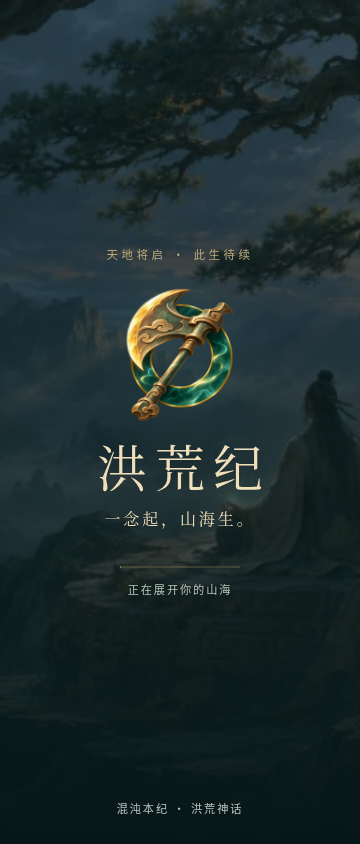
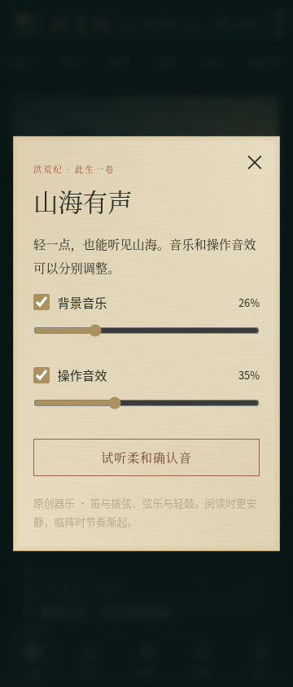
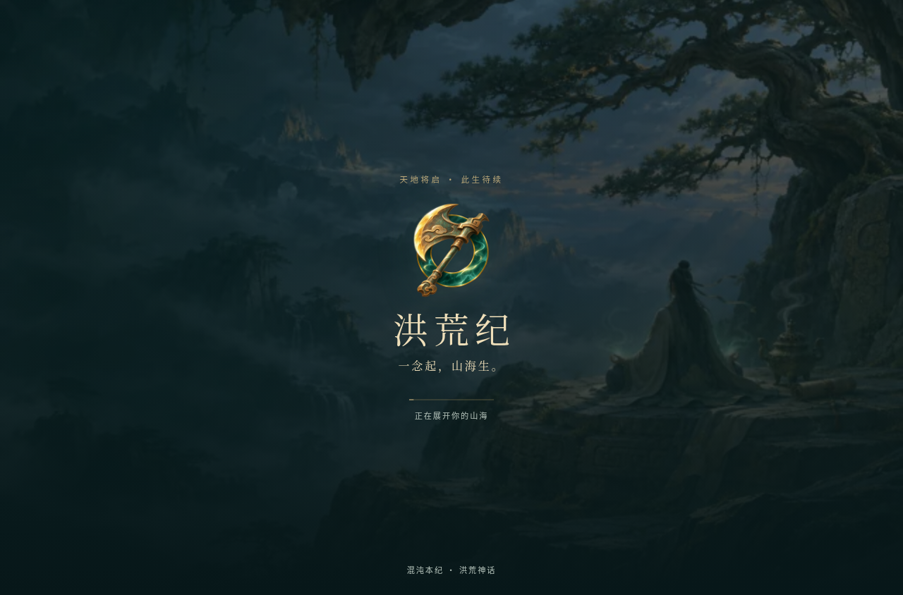

# 配乐、调音与启动视觉验收

2026-11-05，分支 `feat/bronze-choices-combat`。接续[选项与斗法改动](bronze-actions-combat.md)，保留已认可的场景、人物、小说与存档结构。

## 已集成内容

用户确认参考《完美世界》中的《荒》。本轮按现代国风器乐、旋律与节奏更鲜明的方向重新编排；没有使用该歌曲的录音、旋律或歌词，也没有声称制作其翻唱或同等水平的商业原声。

| 本地曲目 | 时长约 | 使用场景 |
| --- | --- | --- |
| 开天行 | 100 秒 | 封面、开天与辉光场景 |
| 逐云 | 109 秒 | 入世、游历与探索 |
| 青岚入定 | 107 秒 | 修炼、打坐、人物页 |
| 山海无涯 | 92 秒 | 山河、苍茫地域 |
| 踏劫 | 103 秒 | 手动斗法、量劫 |
| 墨间月 | 113 秒 | 本纪、天书 |

六首均为为本项目编写旋律、和声与段落后，用采样乐器离线渲染的立体声 Vorbis 文件，包含引子、主题、展开与回归。不是运行时的正弦波短循环。以笛、拨弦、弦乐和轻鼓组合，安静页面降低编排密度。声音文件合计 7,582,988 字节（含六种短音效），按需加载，运行时不访问外站音频。

`scripts/audio/render-score.py` 可复现资源，需 Python、numpy、FluidSynth、FFmpeg 和指定音源。采样音源为 GeneralUser GS 2.0.3，其许可允许发布所创作的音乐录音；完整许可、作者对样本来源的说明、音源散列及来源分别保存在 [CREDITS](../../public/audio/CREDITS.txt)、[完整许可](../../public/audio/GeneralUser-LICENSE.txt) 与 [曲目清单](../../public/audio/score-manifest.json)。音源本体没有打包进游戏。

## 音乐和操作反馈

- 音乐、音效分别开关与调音量；原有总开关保留。设置独立保存在 `honghuang-ji-audio`，不改人物存档；非法音量安全归一化。
- 同一首曲目不因操作、音量或场景标签改变而重播。下一首完成解码才交叉淡化；记住播放位置，后台暂停后续播。
- 静音启动不创建音频上下文。首次用户操作解锁浏览器音频；后台停止音乐与短音效，遵守原有安卓生命周期处理。
- 点击、确认、页面、面板、物品操作、技能分配不同短音；适度削减刺激频段并降低默认音量。修正试听按钮被通用点击音抢先触发的问题。
- 默认音乐 55%、音效 35%，可以继续独立降低或关闭。技术验证不能代替用户实际试听；本轮未进行人工听感验收。

## 加载和图标

真实加载状态改为山海原画、青铜开天斧与苍玉环、标题和微弱光带，没有假百分比或人为延长等待。支持减少动态效果。图片生成来源见[图标说明](../../public/art/app-emblem.md)。

更换网页 favicon、触屏图标、游戏页标识，以及安卓各密度普通、圆形、自适应图标和原生启动图片。保留平台管理的 `public/__grok` 文件与分享图；平台 PWA manifest 引用的图标未改，不能把其安装入口也算作已替换。

## 验证与限制

- `npm test`：301 项通过（197 脚本、104 TypeScript），含旧存档、离线收益、时钟回退与连续行动回归。
- TypeScript、Lint、正式构建、安卓离线网页构建通过。数据库未配置时迁移按原逻辑跳过；客户端存档正常使用。构建仍提示一个大于 500 KB 的 JS 分块，没有为消除提示重写架构。
- 320、360、412、1280px 的浏览器音频检查覆盖真实解码播放、分开静音、调音、刷新保存、同场景不重播、后台停止、恢复非零播放位置、无横向溢出和页面错误。前后台检查模拟可见性事件，不等于安卓系统真机测试。
- 360/1280px 阻塞客户端脚本捕获真实加载界面，放行后能正常进入封面。
- 原有选项与游历回归覆盖连续 20 次真实选择、双击、键盘选择、减少动态效果、策略保存、秘境结算、挂机滚动及停止恢复。
- 正式版本交互检查合计 41 项通过（15 项选项、20 项游历、6 项音频/加载）。通用冒烟脚本固定等待一秒，生产桌面冷启动截到了加载页，因此其正文与开发基线比较报告差异；没有把这项比较写成通过。专门的加载检查等待实际界面就绪，已验证加载后进入封面。两种构建均无页面错误与横向溢出。冒烟脚本的 OG 缺失提示来自错误使用 `/workspace` 根目录；实际仓库 `public/og.jpg` 存在，仓库品牌检查零警告。
- 15 个新增/更新音频与图标资源在 `dist-android` 中与源文件完全一致；12 个 Ogg 文件均可被解码工具识别。主曲测得综合响度约 -18.9 LUFS、真实峰值约 -5.4 dBTP，未削波；这只说明技术电平。
- 检查相对基准提交的新增文件和提交补丁，未发现高置信度 GitHub Token、常见 API 密钥或私钥匹配；这不是完整安全审计。
- 没有 Android SDK，未生成新的 APK，未验证安卓安装、真机后台与实际扬声器听感。未合并或发布。

正式浏览器结果：[音频与加载](../../screenshots/audio-renewal/audio-production-results.json)、[选项](../../screenshots/audio-renewal/choices-production-results.json)、[游历](../../screenshots/audio-renewal/roam-production-results.json)、[冒烟原始记录](../../screenshots/audio-renewal/smoke-production.json)。完整开放世界总纲仍有未完成内容，边界沿用选项与斗法验收报告。

## 截图

