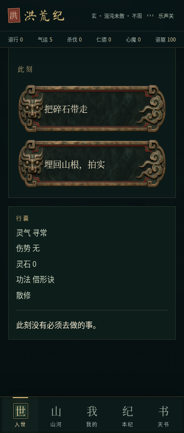
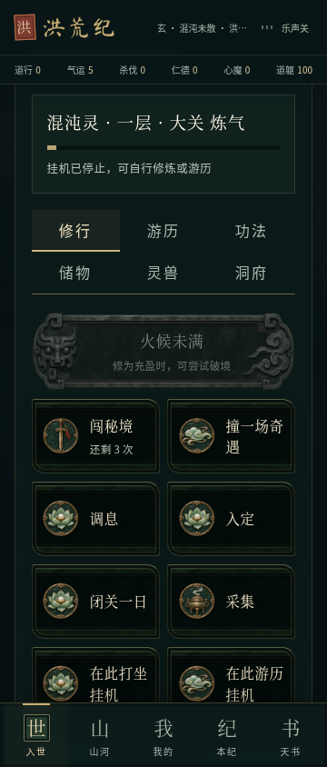
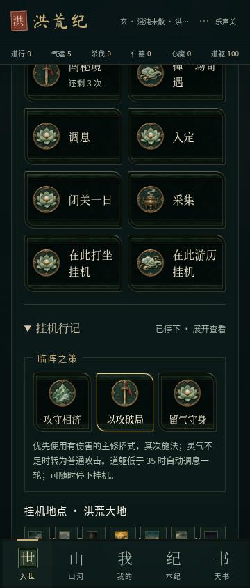
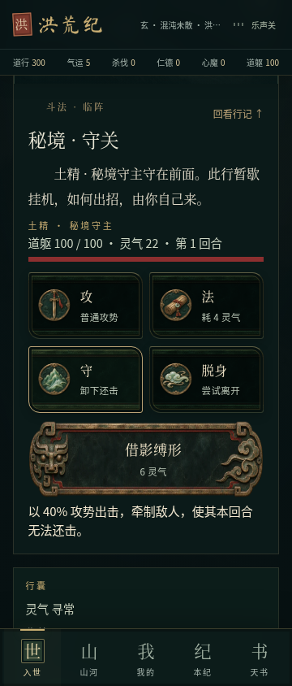
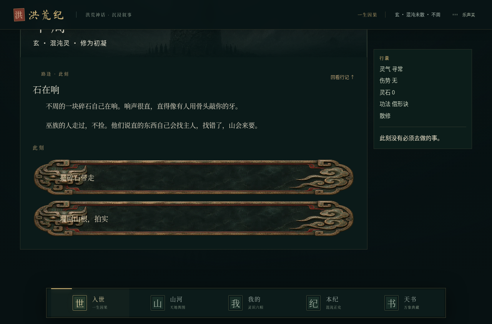

# 选项美术与斗法衔接验收

2026-11-05。基于 `feat/cultivation-codex@8e3a33e`，工作分支 `feat/bronze-choices-combat`。包含上一轮功法与交互修复，没有覆盖 `main`，没有发布。

## 玩家可见的变化

- **选项有实际美术资产**：剧情抉择、根骨、破境和主修招式使用饕餮青铜玄玉铭牌；修炼、攻守、游历、炼制与师承使用六枚原创徽章。旧剧情与开放游历共用组件，文字仍实时渲染。挂机地点入口补入已有场景缩略图。
- **选择有明确状态**：按下反馈、短暂落印、整组锁定后执行，防止双击或连续数字键重复提交。普通演出 200ms；减少动态效果模式取消等待与动画。动作后的变化仍在执行之后揭晓。
- **滚动由操作驱动**：取消对日数、事件 ID、战斗回合和报告标题的自动滚动监听。主动进入事件或查看选择结果时才定位到正文；连续手动出招保留操作区的相对位置。后台挂机不调用这套定位逻辑，保留“回看行记”。
- **自动斗法共用手动回合规则**：每次遭遇由同一个 `combat` 处理攻势、招式、灵气、治疗、护势、牵制、敌人还击与八回合上限，替换原先的战力阈值直接判胜。战报显示实际出招顺序和消耗。
- **三种可保存的策略**：攻守相济、以攻破局、留气守身，决定出招优先级，实际影响灵气与伤势。道躯低于 35 时自动用一轮调息，恢复 12 道躯、3 灵气并减轻伤势。
- **秘境需要真实斗法**：进入会暂停挂机并消耗一次机会。战胜守主后才结算原有修为、灵石、材料和概率护身升级；脱身或失败不能领取胜利奖励。

新增两张 WebP 合计约 177 KiB；完整来源与用途见 [美术说明](../../public/art/action-art.md)。背景场景、小说和音乐沿用已有成果。

## 复现的问题与修复

| 问题 | 复现 | 修复与回归 |
| --- | --- | --- |
| 自动战斗未使用功法招式 | 妖形根骨挂机一轮，原逻辑灵气增加且不调用牵制 | 使用同一回合处理器；测试灵气真实扣除、招式战报、剧情状态不被覆盖 |
| 离线同步与刷图追算走不同规则 | 同一存档离开一分钟，分别执行 sync 和 fight | 同一结算入口与时钟；结果一致，同一时间不重复奖励 |
| 换图丢掉未结算时间 | 离开一分钟后直接换挂机地图 | 先结算旧地图再切换；停止与转修也先结算，领取结果保留 |
| 展开面板撑宽窄屏 | 在 320/360px 展开挂机行记 | 限制 grid 子项与 fieldset 的最小宽度，地图只在自身容器滚动；浏览器回归覆盖展开状态 |
| 悬停覆盖原画 | 旧 choice 悬停规则重置背景 | 专门保留铭牌背景，截图确认普通和悬停状态 |

前三项先建立失败回归，再修改规则。浏览器测试中也修正了两个测试假设：一次点击需要等到落印提交与布局完成；连续体验测试需要实际换地区，不能耗尽同一地点的一次性事件后仍要求继续出现新选择。

## 兼容与数值边界

只增加 `world.battlePlan`，旧存档缺失或值非法时回退为 `balanced`。人物、法宝、剧情、任务、因果与原有 `haul` 结构保留，继续支持导入导出。存档版本不变。

离线与在线逐轮使用相同规则。离线资源留在原有待领记录，生命、灵气、伤势及已装备护身随模拟结算；界面战报明确说明。游历最多暂存 480 轮，打坐仍最多八小时，领取后重新积累。重复同步、重复领取和时钟倒退都有回归检查。

这是有意的玩法变化：挂机会真正消耗资源、受伤和调息，秘境收益需要战斗取胜，旧版每分钟收益节奏因此会变化；没有声称完成长期经济平衡。

## 验证记录

- `npm test`：300 项通过（197 脚本、103 TypeScript）。本轮新增 8 项规则回归。
- 连续行动模拟扩展为 24 个种子 × 120 次行动；九功法 × 三种策略逐回合对照手动斗法；120 次在线行动与离线结算结果一致。
- `npm run typecheck`、`npm run lint`、`npm run build` 通过。数据库配置缺失时迁移脚本按原设计跳过，本游戏存档仍在客户端。
- `npm run build:android` 通过，并核对新原画和已有 UI 音效在离线资源目录中存在；新图与源文件散列一致。客户端构建仍有大于 500 KB 的 JS 分块提示（gzip 约 209 KB），没有为消除提示引入架构重写。
- 浏览器使用 Playwright 与系统 Chromium，覆盖 320、360、412、1280px。新交互检查涵盖 20 次真实剧情选择、双击、旧版数字键、策略保存、秘境奖励、减少动态效果及展开面板无横向溢出。
- 正式构建结果和截图随本报告提交，另保留原有学习、买卖、挂机停止/恢复及滚动回归记录。
- 开发与生产冒烟检查核对可见内容、页面错误、控制台错误和横向溢出。检查脚本将 `/workspace` 当根目录产生的 OG 提示不适用于当前子目录仓库；仓库原有 `public/og.jpg` 保留。

本轮未验证安卓真机、APK 安装或长时间后台。环境有 Java，但没有 Android SDK，因此没有声称生成了新的 APK。

## 总纲仍有的边界

本轮完成选项美术、功法出招、自动/手动回合衔接和秘境战斗这条可玩流程。四族完整差异、多栏功法构筑、NPC 自主行动、三层地点对象及地区长期演化，仍不能按完整设计总纲验收；不把已有菜单或事件数量当作这些系统全部完成。

## 截图

对照：[此前手动斗法](../../screenshots/cultivation-codex/battle-technique-360.png)。

