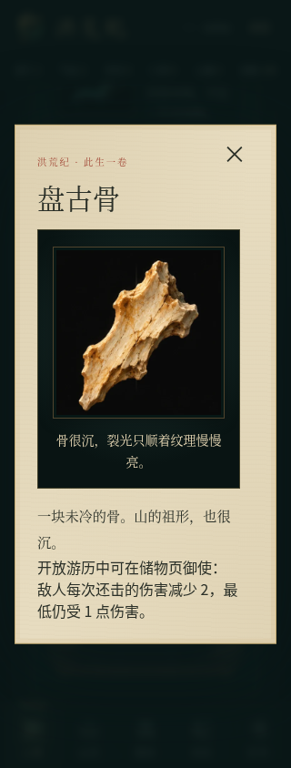
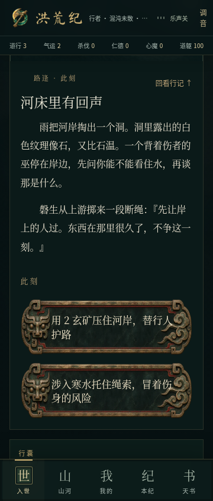
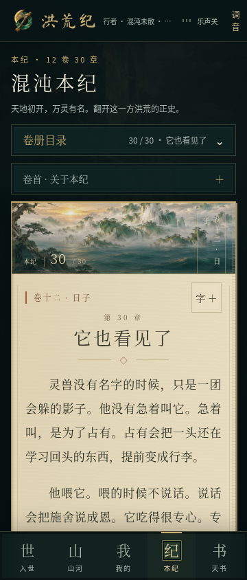
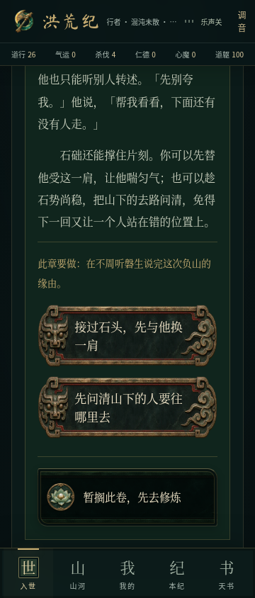
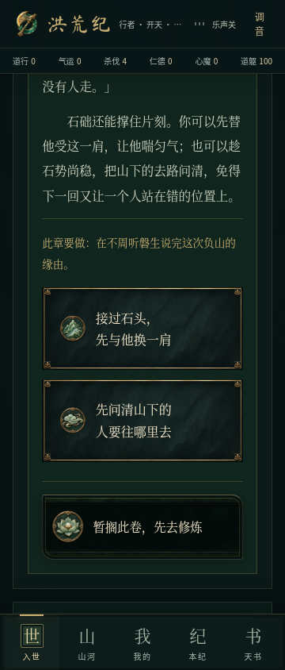

# 《洪荒纪》统一收尾与验收

2026-11-11 实测，2026-11-12 完成交付。分支 `feat/complete-experience`，游戏代码 `660708b6bf04cc1bff043edabc728ea581e6f801`，接续 `feat/painted-choices@08e5161`，包含此前修复、美术、四族剧情、当地探索、势力、御器与参悟成果。统一 PR 对照 `play/open-cultivation@d67a2b5`，不需要用户逐个拼接旧开发分支；没有合并 main 或发布正式版本。

本次按用户最新要求完成既定缺口与统一交付；音乐重做、真机长期体验暂缓。依据对话、现有代码和保留的设计审查收尾，不声称重新逐字核对当前已不在环境中的总纲附件，也无法查看 Grok 未推送的工作区。

## 本轮实际改动

### 修行不再绕过大境界

复现：道行 11、混沌灵九层之前，普通闭关的道行奖励或八层升九层会直接越过道行 12，境界名称变成炼气，却没有进行大境界突破。事件奖励也存在同一问题。

先添加回归测试，在旧实现复现 3 项失败、2 项通过；修复后普通修炼、事件奖励和小层突破只积累到本境上限，并明确说明关口。第九层的成功破境才打开下一境；失败保留原境界并结算既有代价。已保存的境界不被降回去，最高境界原有上限保留。

新增 5 项测试覆盖各境界、事件奖励、小层、大关成败、旧进度与顶境。没有新增存档字段或重写突破系统。

### 九器都有开放游历获取来源

原有九器已能御使，但新开开放存档缺少盘古骨、诛仙剑意、息壤的获取路径。本轮补齐三条两阶段地域任务及三个延迟回访事件，共 9 个事件：

| 器物 | 因缘与行动 | 既有用途 |
| --- | --- | --- |
| 盘古骨 | 洪荒大地护住渡河者，再到不周为负重者疗伤；后来收到自行脱落的骨片 | 承受还击时护身 |
| 诛仙剑意 | 血海护渡、修复旧阵，让剑锋留出归路；两日后有回信 | 增强真实斗法攻势 |
| 息壤 | 娲皇天护苗，再替人间雨棚备下火种与药草；三日后收到余土 | 成熟药圃增加收获 |

已知材料消耗在选项中写明；涉险路线事先说明意图与风险。不同初次选择留下不同因果和后文。材料不足时可暂缓，在洞府的因缘入口继续；不是扣费后卡住。法宝在延迟事件的实际选择后才交付，不能重复领取，既有法宝效果不变。

4 项新增测试验证九器来源齐备和三条完整路径，包括普通区域探索发现、真实付费、材料不足、暂缓、存档恢复、延迟到达、单次领取与御使。浏览器另完成三条任务的实际点击和重载。

### 本纪、天书和器物详情收齐

- 本纪 30 章按稳定章节 ID 映射本地插画，补上后 16 章的对应场景；展示实际的 12 卷 30 章，原文不删改。新增测试要求每章的大、小图均实际存在。
- 天书「法宝」使用器物场景，「山河」使用山河图；分类正文、搜索和展开功能保留。
- 九器列表使用 720px 轻量图集；详情使用已有 1440px 高清图集，按弹窗可用宽度展示，最大 240px。320px 下不挤出屏幕，仍有各自的轻量特效、关闭和键盘操作。
- 本轮复用已有原创本地绘画，没有将 CSS 或占位图称为新原画。此前四族选择牌面、人物肖像与长卷场景全部进入统一版本和当前 APK。
- 为新事件补入 11 个正文字体汉字，保留全部旧码位，共 1,965 个码位。来源和 OFL 许可见 [字体记录](../../public/fonts/CREDITS.md)。

### 首屏按需加载

入世、山河、我的、本纪、天书分别懒加载；天书静态长文从基础世界数据分出，首次需要时才加载。页面加载有简短可读状态，不改游戏状态结构或平台配置。

同一环境的 Android 离线构建首屏静态引用：

| 资源 | 上一版本 | 本版 | 减少 |
| --- | ---: | ---: | ---: |
| 初始 JS 合计 | 713,704 B | 582,338 B | 18.4% |
| 初始 CSS | 128,031 B | 60,112 B | 53.0% |

这是资源体积对比，不是低端真机帧率或启动耗时承诺。离线构建仍有单个 JS 分块超过 500 kB 的提示；没有调高阈值掩盖它。详细文件见 [体积记录](../../screenshots/complete-experience/bundles.json)。

## 统一验证

| 检查 | 结果 |
| --- | --- |
| `npm run typecheck`、`npm run lint`、`git diff --check` | 通过 |
| `npm test` | 386 项通过：197 项脚本测试及 189 项 TypeScript 测试 |
| 连续玩法模拟 | 包含 24 个种子 × 120 次不同合法行动，无死锁；旧存档、离线重复结算、时钟回退、长间隔收益均有回归 |
| `npm run build` | 通过；未配置外部数据库，按原项目规则跳过外部迁移 |
| `npm run build:android` | 通过，本地资源和分块进入离线目录 |
| 开发与正式构建冒烟 | 桌面、手机均有内容，无控制台错误，正式版与开发基线不偏离；两组截图已目视检查 |
| 全面浏览器回归 | 89 个不同用例通过：本轮 17、游历反馈 20、四族牌面 16、阅读衔接 12、当地世界 12、御器参悟 12 |
| 320 / 360 / 412 / 1280px | 页面、按钮、法宝弹窗、地图、章节、分类可用，无横向溢出；360px 覆盖减少动态效果 |
| 连续 20 次选择 | 同一存档经过大地、混沌、世界边缘、人间、娲皇天，20 个不同事件，含旅行及战斗脱身；没有调用回页顶滚动，结果可读 |
| 后台挂机 | 实测自动回合更新修为时不调用剧情滚动；地方人物面板的阅读位置保留；停止后不被定时器重新开启 |
| 存档 | 原人物、器物、剧情标记保留；导入导出和旧版本回归通过，新任务延迟队列可以保存恢复 |
| 凭据检查 | 扫描工作区文本及基准后新增提交补丁，常见 GitHub Token、私钥、云访问密钥和服务密钥模式无命中；未打印匹配值 |

本轮 17 项新增浏览器验收在正式构建全部通过，见 [机器结果](../../screenshots/complete-experience/results.json)。其他各组 JSON、开发与正式冒烟记录、凭据扫描记录同目录保留。测试使用独立夹具存档，没有接触真实玩家存档。

冒烟工具误以 `/workspace` 为项目根，给出缺少 OG 图片的提示；在真实仓库根执行 `node scripts/brand-check.mjs --game` 返回 `ok: true`、0 警告，实际分享图已存在。构建还有依赖包的 `use client` 打包提示，未导致失败。

独立只读审查确认新任务沿用既有持久化字段，未发现重复发奖、无法继续的任务或懒加载遗漏存档状态的代码路径。

安卓原生构建与模拟器结果见 [Android 交付说明](../android.md)。成功工作流：[42971167830](https://github.com/mistwood38/honghuang-ji/actions/runs/42971167830)，打包及验收提交 `97fc19b`。Android 15 / API 35 模拟器六项流程全部通过：飞行模式冷启动、旧存档御器与参悟、五个离线懒加载页面及高清详情、12 个本地音频解码、HOME 后续播、强停后恢复人物/器物/剧情与已付费进度。[原生机器记录](../../screenshots/complete-experience/android/results.json)随仓库保存。

首轮原生验收在 WebView 的 CDP 截图步骤连接关闭，未标记为通过。改为 ADB 获取真实屏幕，并继续使用原来的 WebView 连接执行后续全部断言；复验六项通过。仅修改测试截图与失败诊断，没有通过重连跳过异常，也没有为这次复验改动游戏逻辑。原生 APK 内 109 个本地资源与源码逐字节一致，记录见 [APK 校验](../../screenshots/complete-experience/apk.json)。

## 画面与对照

| 法宝详情 · 320px | 新任务与选项 · 360px | 后半本纪 · 360px |
| --- | --- | --- |
|  |  |  |

| 之前的分支选项 | 统一版本的四族牌面 |
| --- | --- |
|  |  |

[封面](../../screenshots/complete-experience/smoke-prod.png) · [手机封面](../../screenshots/complete-experience/smoke-prod-mobile.png) · [人物](../../screenshots/complete-experience/character-360.png) · [山河](../../screenshots/complete-experience/atlas-412.png) · [天书](../../screenshots/complete-experience/codex-360.png)

## 明确边界

既定收尾功能已经实现，继续扩写每位神灵、更多长篇剧情或重新制作九套序列帧，不列为这次交付的隐含欠项。游戏仍是有边界的独立文字 RPG，自动化验收不能代替数十小时的玩家经济平衡体验。

音乐听感按用户要求暂缓重做，保留已有本地音频。没有进行安卓真机扬声器、耗电、低端机性能、长时后台及跨签名覆盖安装测试；模拟器结果不代替这些检查。平台管理的 PWA 图标和品牌注入仍按原项目约束保留。
