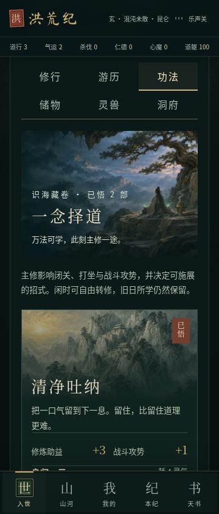
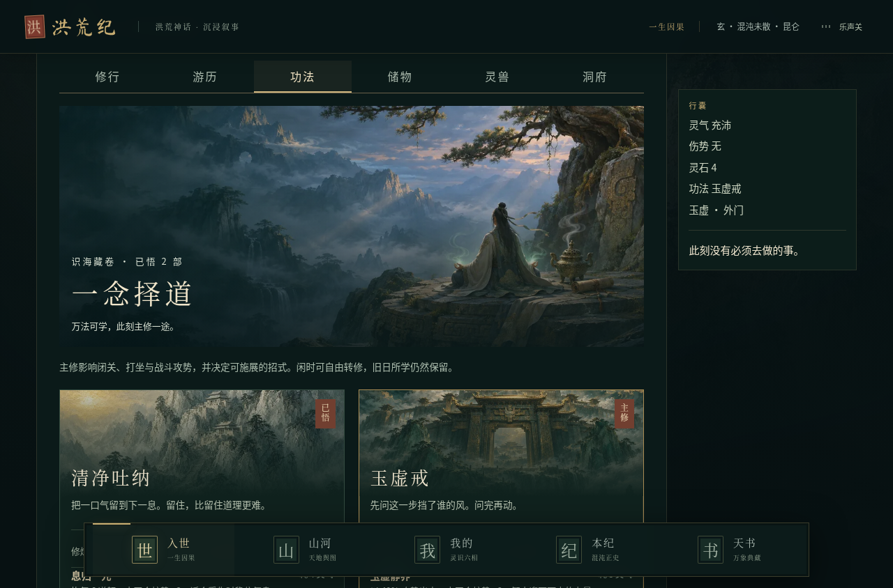
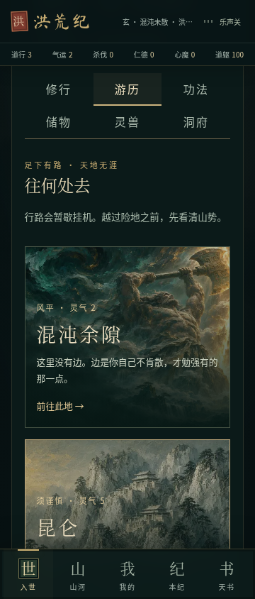
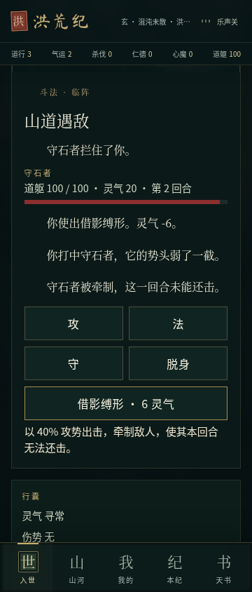

# 功法闭环与游历美术升级

2026-11-04；基于 `fix/roam-feedback-controls@9dd7fae`。本分支包含之前的交互与挂机结算修复，目标分支仍为 `play/open-cultivation`。

## 实际交付

- **可配置主修**：只显示已学功法，可在闲时自由转修。主修真实影响已有闭关、打坐和战斗攻势；切换前按旧功法结算已过去的打坐时间。战斗、事件和入定期间不能转修，未学功法不能装备。
- **九部已有功法的临阵招式**：加入恢复、护势、牵制、强攻及其组合，统一列出已知灵气成本与效果。牵制会跳过敌人这一回合的还击；护势在敌人还击后消耗；治疗有生命上限；灵气不足不会白白消耗回合。仍保留原有攻、法、守、脱身。
- **实际学习路径**：游历到昆仑 → 拜见玉虚 → 完成四次门中委托 → 花费既有的八贡献学习玉虚戒 → 在功法页设为主修 → 刷新后主修保留。原有事件传承也进入同一个功法库。
- **手机操作层级**：主动修行在前，自动刷图与行记收入可展开面板；停止/恢复入口仍可直接使用。六个分页在窄屏排为两行，主动切换分页时定位到分页区域，后台回合不触发定位。
- **真实场景美术**：新增原创洞府修行绘画，制作为本地 WebP（1200px 约 108 KiB，640px 约 35 KiB）；来源见 `public/art/cultivation-sanctuary.md`。功法卷面与旅行卡片复用已有合法场景原画，按需加载。图片承载场景，文字放在清晰独立区域。

## 存档与规则边界

复用现有 `arts`、`equipped`、`spells`、战斗及本地存档结构，没有增加持久化字段。旧存档继续读取；非法或未学的主修 ID 安全回退到已学的有效功法，物品、剧情记录和任务继续保留。新招式的数值属于本轮可调整的玩法实现，不代表总纲已经确定最终平衡。

本轮未重写挂机结算、原有故事事件、小说、音乐或境界平衡。**招式用于手动斗法；挂机尚未与手动战斗共用技能结算，不能认定 A06 已完成。**

## 对照总纲的状态

| 范围 | 现状 |
| --- | --- |
| 原有宗门、功法收藏、修炼、存档 | 可复用，已接通主修选择与反馈 |
| A05 修炼与功法配置 | 本轮补上自由切换及实际作用；完整领悟体系、多栏构筑与突破能力变化仍需后续 |
| A14 已知信息 | 功法助益、招式效果与成本可见，未知事件奖励不提前展开 |
| A12 手机操作 | 通过浏览器尺寸模拟；安卓真机仍未验证 |
| A01、A02–A04、A06、A08–A09 的完整目标 | 四族行动差异、三层地点对象、多解遗迹、统一战斗规则、NPC 行动与地区演化尚未全部完成 |

本轮完成的是可运行的“学习—配置—修炼/斗法—读档”环节，**不是总纲 P0 的整体完成声明**。

## 验证

- `npm test`：292 项通过（197 脚本 + 95 TypeScript），新增五项针对功法配置、限制条件、战斗后果、资源不足和师承读档的测试。
- `npm run typecheck`、`npm run lint`：通过。
- `npm run build`：通过；无服务端数据库配置时，迁移脚本按原项目设计跳过，游戏继续使用本地存档。
- 浏览器：320、360、412 和 1280 宽度，正式构建的 20 项交互检查通过。开发版同样跑过完整流程，分页定位调整后另复查 360px。
- 验证了真实点击拜师、四次委托、学习、转修与页面刷新恢复；验证招式扣灵气、敌人掉血与牵制跳过还击；原有选择正文、买卖反馈、停止/恢复、旅行以及挂机不强制滚动回归继续通过。
- 检查页面错误、控制台错误与横向溢出；人工查看手机和桌面截图。当前环境没有 `agent-browser`，使用 Playwright 与系统 Chromium。
- 提交前扫描本轮暂存文本中的 GitHub Token、常见 API 密钥、AWS Access Key 和私钥标记，未发现高置信度凭据泄露；此检查不等于完整安全审计。
- 首次新增读档浏览器测试误认为刷新总会回封面；实际项目恢复到上次页面，因此修正为等待游历界面并检查持久化状态，产品代码没有为测试改动读档行为。
- 未做安卓真机、APK 重打包、长时后台和完整九功法平衡测试。

复跑交互检查：

```sh
node --experimental-strip-types scripts/roam-feedback.browser.mjs http://127.0.0.1:8080/
```

## 截图

改动前参见 [上一轮操作界面](../../screenshots/roam-feedback/controls-360.png)。








