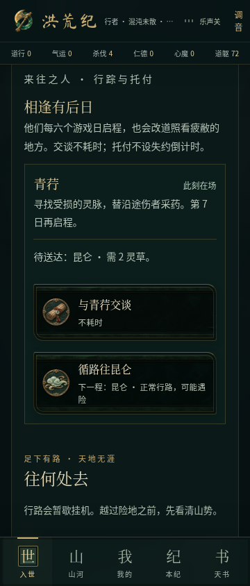
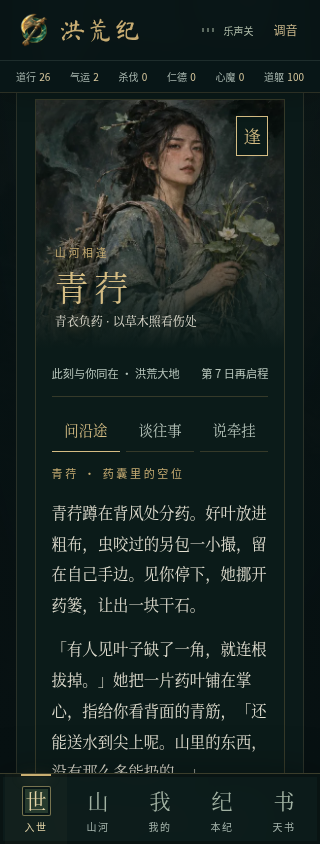
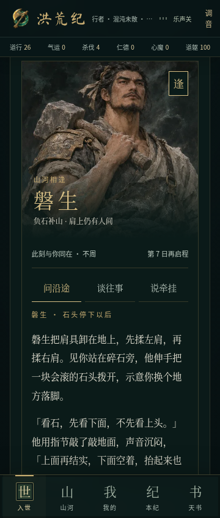
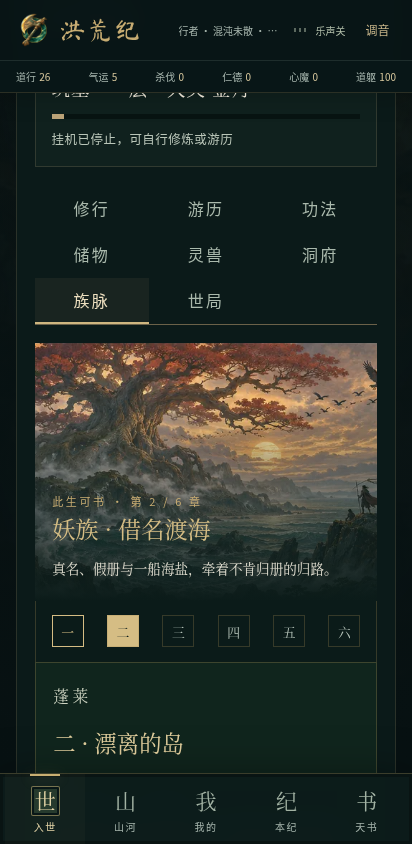
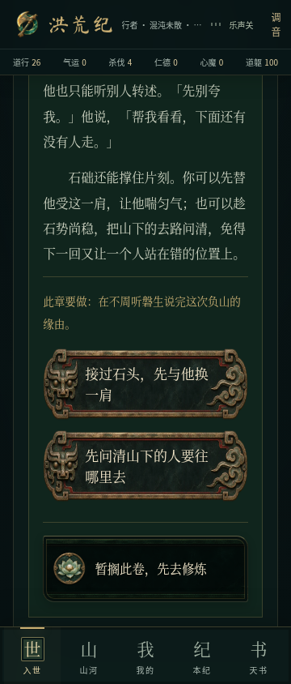
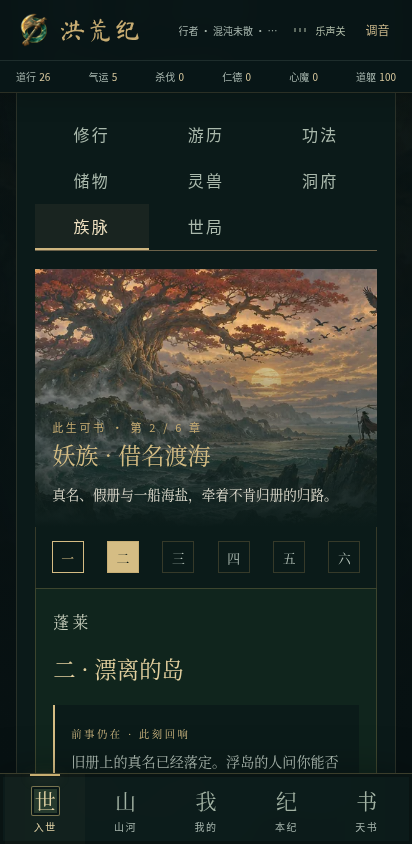
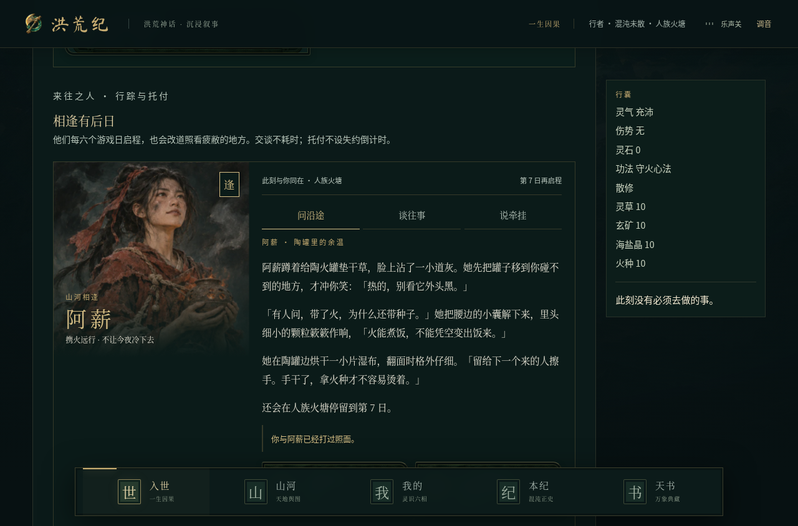
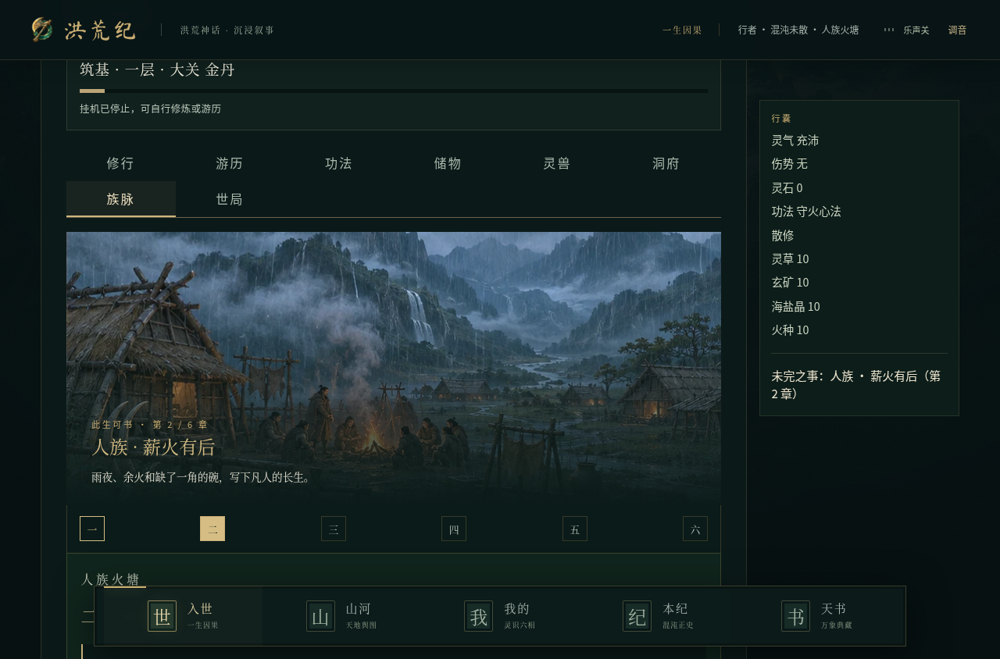

# 四族长卷与行旅相遇验收

2026-11-09，`feat/epic-encounters`，基于 `feat/relics-and-insight@1b7f007`。按用户最新要求集中提升剧情与美术；音乐与安卓真机验收暂不推进。

## 剧情与人物

- 重写灵、巫、妖、人四条既有路线的 24 章正文和 48 个选择结果，以具体动作、对话和不同立场推进故事。不是新增 24 章，仍为每族六章、八种结局。
- 第二、四、六章加入共 24 种「前事回响」，读取旧选择历史，回应第一、三、五章的具体决定。没有新增存档字段，也没有提前揭晓未来收益。
- 青荇、雾尾、磐生、阿薪增加初遇／重逢，以及「问沿途」「谈往事」「说牵挂」。对话读取当地疲敝、遗迹修补、关系和托付的未接／在途／送达／复命／多次完成状态；切话题不耗时、不扣材料、不刷关系。
- 人物及地点行动的结果留在对应卡片。长卷保留明确续读、青铜选项与落印；六章进度不展示未来标题，结局补全最终选择的实际结果，已读卷册可回看先前因果。

## 实际美术资源

四位人物肖像和四幅族脉山河，打包为两套 2×2 原创绘画图集，各有桌面与手机 WebP。手机资源合计 354,000 字节（约 346 KiB），按需加载且全部本地可用。出处、完整提示词与尺寸见 [美术记录](../../public/art/epic-encounters.md)。

人物卡片增加原画、姓名题签和行踪；手机上下排布，桌面人物与对话并列。长卷采用对应根骨的山河画面、章序和独立阅读区；图集保持原比例，外层裁切。对话仅短暂淡入，尊重减少动态效果。

正文字体保留旧版全部码位，补齐 757 个汉字；横排子集共 1,954 个码位，487,716 字节，比旧版少 50,188 字节。来源为 Noto Serif CJK SC，SIL OFL 1.1，见 [字体记录](../../public/fonts/CREDITS.md)。

## 兼容与发现的问题

旧人物、器物和剧情字段保留。回归快照逐项比较全部旧选择 ID、消耗、效果、条件、地点和结局，均不改变。八种旧结局存档仍恢复为六章历史；新回响从既有选择推导，未知 ID 安全跳过。

1. 宽屏时，场景容器的最小宽度覆盖了固定高度，导致图集被拉伸。先由浏览器比例断言复现，再改为按容器宽高取覆盖尺寸，保持画面原比例。
2. 在「谈往事」或「说牵挂」下点击「与人物交谈」，新回执被当前话题隐藏。先补浏览器回归并确认失败，再在新交谈回执到来时选中「问沿途」并定位回复；该逻辑不订阅挂机更新。
3. 中途修改文件时，一次开发环境浏览器运行因 DOM 脱离而失败；未算作通过。冻结代码后重新完整运行，并另测正式构建。

## 验证

- `npm run typecheck`、`npm run lint`、`npm test` 通过：197 项脚本测试 + 167 项 TypeScript 测试，共 **364 项**，包括本轮新增 14 项。
- **36 项不同浏览器用例通过**，覆盖 320、360、412、1280px：新增人物／长卷 12 项、已有阅读 12 项、境内游历 12 项。新增与阅读两组另在正式构建完整复测通过。360px 新用例启用减少动态效果。
- 新用例实际检查肖像／场景解码和比例、三类免费对话、话题后重新交谈、接单／送达／复命、两种旧选择的不同回响、旧结局档案和继续修行；托付送达／返回用固定地点存档隔离动作验证，不能据此宣称四条路线全部实际走过。
- 原游历回归包含挂机时阅读位置稳定、人物托付与战斗配置；阅读回归包含结果定位、明确续读、世局支援及战后返回。浏览器未记录横向溢出、页面错误或控制台错误。
- 开发版与正式版启动烟雾测试均通过，桌面和手机截图实际查看；正式版未偏离开发版。通用脚本把 `/workspace` 误当项目根目录而报告分享图提醒，仓库根目录的 `brand-check --game` 实际为零警告。
- `npm run build` 与 `npm run build:android` 通过。未配置数据库，沿用项目规则跳过外部迁移；仍有大于 500 kB 的主 JS 包提示。本轮四个 WebP 和正文字体与 Android 离线构建逐字节一致。
- 本轮新增与修改文本的常见 GitHub Token、API 密钥、私钥、AWS Access ID 模式扫描无命中；未打印凭据。这不是全面安全审计。独立只读审查发现的对话切换问题已修复并复测。

## 边界

本轮没有增加新的战斗或成长规则，也没有扩写原小说全文。四条路线仍各六章；新画面是静态原画配轻量 UI 过渡，并非逐帧角色动画。多小时玩家体验和长期经济平衡未在本轮完成人工测试。

Android 离线网页构建与资源打包检查不能代替原生 APK／真机验收。本轮未重新构建或发布原生 APK，旧下载包仍对应上一轮。音乐文件和开关逻辑保持原样。没有合并 main 或正式发布。

## 截图与证据

旧截图保留于上一轮目录；新截图来自本轮正式构建，测试存档彼此隔离。

| 升级前：人物文字卡 · 360px | 升级后：青荇相逢 · 320px | 磐生对话 · 360px |
| --- | --- | --- |
|  |  |  |

| 妖族场景 · 412px | 巫族选择 · 360px | 前事回响 · 412px |
| --- | --- | --- |
|  |  |  |

[新增用例：开发版](../../screenshots/epic-encounters/dev-results.json) · [正式版](../../screenshots/epic-encounters/production-results.json) · [阅读正式版](../../screenshots/epic-encounters/reading-production-results.json) · [原游历回归](../../screenshots/epic-encounters/living-dev-results.json) · [离线资源](../../screenshots/epic-encounters/offline-assets.json)
