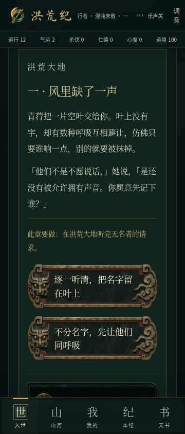
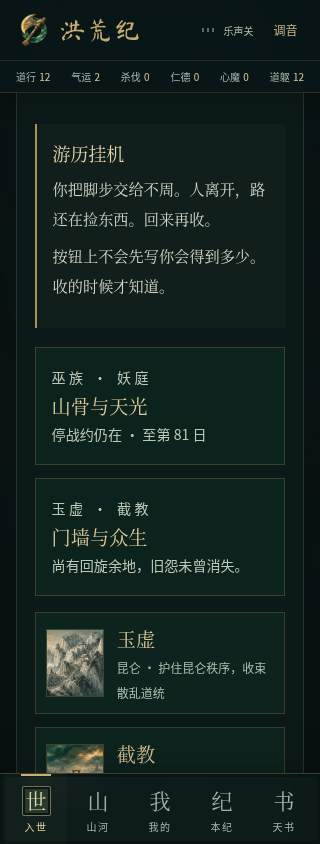
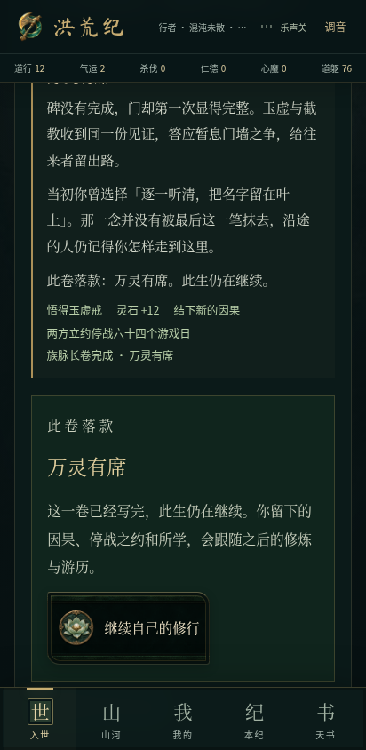
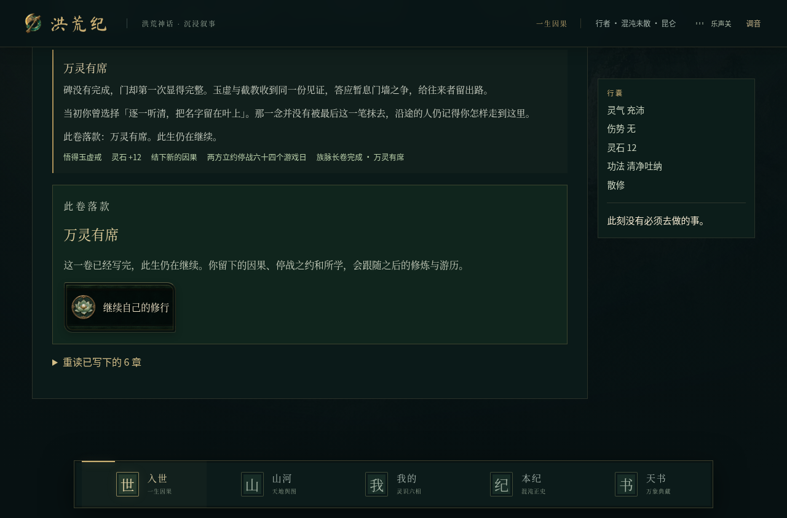

# 四族长卷与神魔世局验收

日期：2026-11-07。基于 `feat/living-regions` / `3fa559f`，开发分支 `feat/factions-lineages`。这是前两次交付的增量，不覆盖 `main`，不发布正式版本。

## 已实现

- 族脉：灵、巫、妖、人各六章，24 章、48 个章节选项、8 个结局。每条路线包含行路、遗迹修复成熟、物资交付、取得信任、真实斗法和最终分支。失败或脱身不算完成试炼，能养伤再来。结局后照常修行与游历。
- 结局的持续影响：调停结局留下 64 游戏日停战约；守护结局增加对应势力声威和补给；均保留因果、章回档案和所授功法。章节中不同立场也会改变声望。选项之前只显示行动意图和已知消耗，收益在操作后揭晓。
- 世局：玉虚、截教、巫族、妖庭、火塘每八个游戏日整备、补给或护地；巫妖、阐截冲突在相应年代逐步激化。争执会改变护路主导、当地疲敝与生息，停战约能够阻止争执。不会擅自杀死原著神祇或改写原主线结局。
- 玩家可在实际驻地援助、递停战书、参加巡护斗法；散修同样可以参与。支援消耗真实物资；巡护只有战胜后才结算奖励；资源与冷却均在引擎检查。
- 族脉与世局界面沿用本地原创插画、青铜选项牌和现有声音系统。正文保持可读，已完成章节可以重读，目的地通过既有行路机制到达。
- 新增 `world.politics`、`world.lineages` 的缺省值和输入归一化，保留存档版本 2、原人物、物品、主线和当地探索记录；无新第三方运行依赖。

## 发现并修复

连续使用普通攻击时，相同战报文字被作为 React 列表键，导致重复键警告。新浏览器测试先复现，再将纯文本战报按显示位置区分；未改变攻击或伤害规则。

新动作沿用先结算挂机、再验证资源的流程，避免点选时看似足够、实际结算后不足还继续扣费。剧情动作携带章节号，重复点击和旧动作不能再次结算。

## 检查结果

- `npm test`：331 项通过（197 脚本测试 + 134 TypeScript 测试），其中新增 17 项。覆盖全部八条完整结局路线、真实修补/援助/试炼、防重复、战败与脱身、存档迁移、批量与逐日世局调度一致性，以及 120 次后台战斗不推进世局、不覆盖剧情结果。既有多种子长程模拟一并通过。
- `npm run typecheck`、`npm run lint`、`npm run build`、`npm run build:android`：通过。未配置数据库时迁移按项目原有规则跳过，本地存档功能不依赖它。
- 安卓离线构建仍有单包超过 500 kB 的 Vite 提示；本次没有为消除提示重构原架构。
- 新增文件与差异的常见 GitHub Token、AWS Access Key、私钥模式扫描：未发现命中；未输出任何密钥。该检查不等于全面安全认证。
- 开发与正式构建的桌面/手机首屏检查通过，正文一致、无横向溢出、无控制台错误。首屏脚本误以 `/workspace` 为品牌根目录给出缺图提示，仓库实际 `public/og.jpg` 存在，独立 `brand-check --game` 为 0 警告。

- 新功能浏览器测试：12/12，通过正式构建运行，覆盖 320、360、412、1280 像素。每个尺寸实点旧档续玩、族脉防重复、真实试炼胜利、续章、行路、结局后继续、支援扣费、停战、巡护胜利。滚动检查期间确实开启挂机并观察到战斗时钟更新。
- 既有 `roam-feedback.browser.mjs`：20/20。保留剧情反馈、挂机阅读位置、功法与控件行为。
- 浏览器结果文件：[新功能](../../screenshots/factions-lineages/results.json)；原有回归的日志已在开发环境保留。

## 截图

| 族脉与青铜选项（360px） | 世局（320px） | 结局（412px） |
| --- | --- | --- |
|  |  |  |

## 安卓测试包

- 原生构建成功：[运行 42363847760](https://github.com/mistwood38/honghuang-ji/actions/runs/42363847760)，对应游戏代码提交 `fc44e5c17f93dcdb6a0f2e130b07b3cdc725fd79`。
- [下载 honghuang-ji-debug](https://github.com/mistwood38/honghuang-ji/actions/runs/42363847760/artifacts/13571255518)，需登录 GitHub，产物保留至 2026-11-21。解压后为 `app-debug.apk`，APK 22,980,131 字节（约 21.9 MiB）。
- 实际下载并打开 APK 检查：包含新版族脉代码、12 个本地音频文件（6 配乐 + 6 音效）和 76 个美术资源；音频内容与项目原文件逐一一致；没有配置远程网页作为客户端入口。
- 下载的 artifact ZIP 摘要与 GitHub 返回值一致。APK SHA-256：`eb411584cc91fa6fc86d93507eece62080f9bf08a1be07604196ae4bd924c56d`。
- 这是 debug 安装包，未进行真机安装、飞行模式、系统后台恢复或听感验收；以上仅为原生构建和包内资源验证。

## 范围与限制

本次补全的是上次留下的族脉流程与势力演化；没有扩写《混沌本纪》正文，也没有新增音乐或替换已经认可的美术。长期数值平衡仍需要更多真实玩家反馈。浏览器手机尺寸测试不等同于安卓真机安装、音频听感、系统后台和飞行模式测试。
