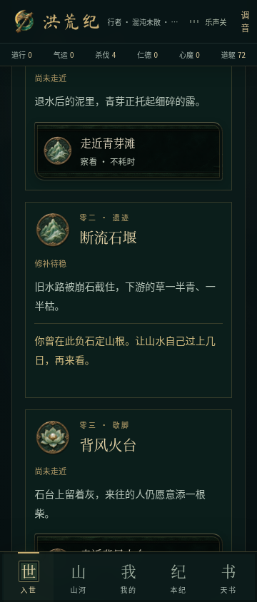
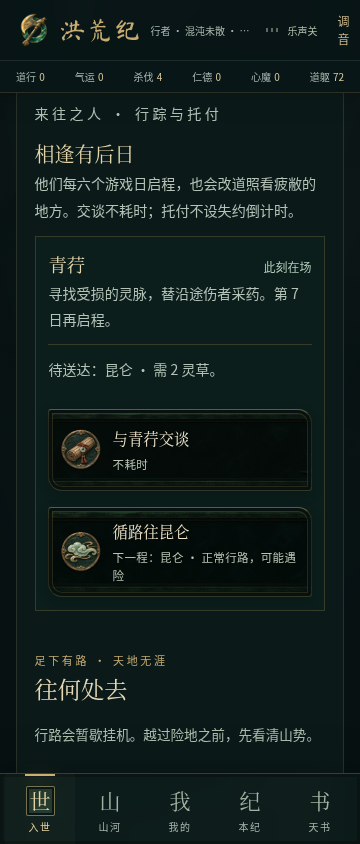
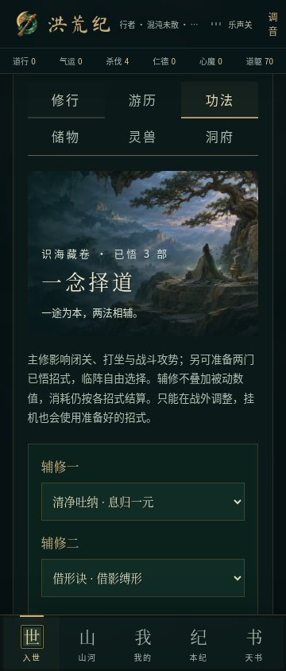
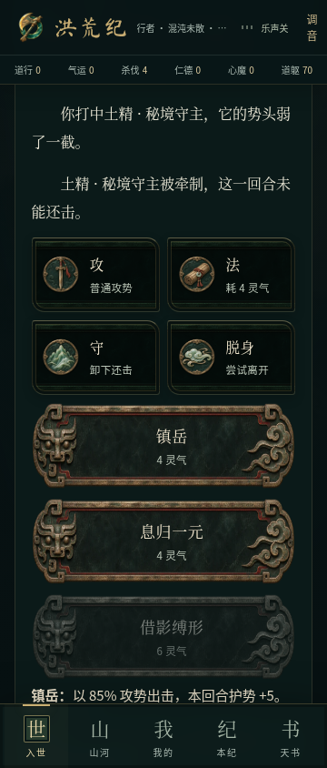

# 境内探索、人物托付与辅修验收

2026-11-05 开始，2026-11-07 收尾。基于上一轮 `1c678c9`，工作分支 `feat/living-regions`。开始前已 fetch 并核对远端：`play/open-cultivation` 仍为 `d67a2b5`，上一轮分支仍为 `1c678c9`。不覆盖 main，不合并或发布。

## 这轮实际补上的玩法

### 地区 → 地点 → 操作

入世的「游历」页现在先呈现所在地区的境内内容，再列出远行入口。13 个已有地区各有一处物产、一处遗迹、一处歇脚地，共 39 个有名称、描述和独立状态的交互地点。沿用现有场景、青铜选项和绘画徽章，没有把菜单入口计为玩法完成。

- 察看不耗时，不凭空发奖。察看后显示该对象真正可执行的操作。
- 物产有独立休养期；反复采撷使当地疲敝，疲敝会降低该地点的产出。
- 遗迹可以修补或拆取。修补要真实消耗资源，数日后才恢复当地生息；拆取留下因果、损伤当地状态，并需等候才能补救。
- 歇脚处的恢复量受当地状态影响。可以投入灵草护养，形成取用、归还、重访的循环。
- 地区状态、修补方法、待生效时间和近闻都写入存档。远在别处时，之前留下的修补也会按游戏日成熟，不需要再次打开这个地点触发。

### 四种根骨有不同的探索解法

保留 `dao/wu/yao/ren` 原始键、根骨、初始数值和人物素材，增加对应的灵/巫/妖/人身份说明：循灵脉耗灵气，负石耗道躯，循兽径多耗一天，联众手耗灵草。也保留人人可用的玄矿修补方法。所有消耗都在操作前显示；实际变化在执行后显示。

这已是可执行的解法差异，但不等于为四族各写了整部独立主线。

### 会行走的人与可重复托付

新增四位沿途普通人物：青荇、雾尾、磐生、阿薪。他们有持久化位置、行程计数、下次启程日、目标和与玩家的关系；每六个游戏日沿自己的路线行动，优先转向路线中疲敝的地区。没有改动原著神灵的行为或小说正文。

交谈、接下托付、筹集物资、到目的地送达、带回信寻人复命是真实分开的步骤。人物走后可查看行踪，路径按钮只走原来的合法旅行规则，仍可能遇险。已送达的任务不会因人物离开失效，也没有强制过期惩罚。

送达消耗物资并改变目的地状态；复命才发盘缠并增加关系。重复点击不重复领奖，完成后至少四个游戏日才有下一次托付。完成两次后，人物可传授其根骨对应的已有功法。任务状态进入侧栏，避免有未完托付时仍显示「没有必须去做的事」。

### 主修与两格辅修

功法页可在主修之外准备两门已学招式。主修继续决定修炼与基础攻势，辅修不叠加被动数值；每门招式的灵气、治疗、护势、牵制照原规则结算。临阵显示已准备的招式，自动斗法也能按三种策略使用。战斗或入定期间不能换法，未学习、重复及与主修重复的配置会被拒绝。

## 兼容和明确边界

- 新增 `world.living` 和 `world.prepared`，旧档缺失时补初始状态；不改人物、法宝、剧情、前尘、任务和旧因果记录，不升级外层存档版本。
- 新世界从旧档保存的游戏日开始，避免凭空追发旧年份的收益。新增字段做白名单和有限数值处理，异常日数安全归一化。
- 后台每 2.5 秒刷图不推进 NPC 日程、不替换正文，也不触发阅读定位。玩家主动领取离线收获时，沿用原有「推进若干游戏日」规则，再按时间先后处理人物启程和修补成熟。
- 地区状态目前直接作用于新境内物产与歇脚处，未偷偷修改旧交易价格、旧奇遇或所有怪物强度。任务消耗与五灵石盘缠是新增循环的数值，尚未完成长期经济平衡验收。
- 复用既有美术、音乐、图标和字体；本轮没有新增外部素材或运行时资源依赖。

## 发现的问题与回归

1. **先结算挂机再扣修补费用**：建立用例，复现点击时有四点灵气、结算刚结束的自动战斗后不足，仍扣四点导致负数的问题。修复为结算后再验证操作条件，失败则停下挂机并说明原因，不重复扣费。
2. **跨多日结算的先后顺序**：建立用例，复现一次推进八天会让第八天的修补影响第七天人物去向。改为按到期日逐项执行，逐日推进和一次领取的世界状态完全一致。
3. 测试中更正了「从昆仑可直接首次到娲皇宫」的错误假设，改走原道路；UI 同样给出下一程提示，没有增加传送捷径。

## 验证

- `npm test`：314 项通过（197 脚本、117 TypeScript）；新增 13 项地点、四族成本、地区后果、移动人物、重复领奖、迁移、挂机稳定、多招式及时间顺序测试。
- 新增四种根骨各 120 次境内操作模拟；原有 24 个种子各 120 次行动模拟继续通过。自动/手动斗法对照新增三种策略下的辅修组合。
- `npm run typecheck`、`npm run lint`、正式构建、安卓离线网页构建通过。数据库未配置按原逻辑跳过迁移。客户端分块约 615 KB、gzip 219 KB，仍有超过 500 KB 的构建提示。
- Playwright 与系统 Chromium 检查 320、360、412、1280px：从缺少新增字段的旧档开始，真实点击察看、修补、采集、送达、返回复命、挂机阅读、辅修配置、刷新恢复、秘境出招。12 项新流程检查全部通过，结果与截图随本报告提交。
- 原有剧情选择、双击、数字键、滚动、挂机、交易和功法流程的 35 项浏览器回归通过，本轮正式版本交互检查合计 47 项。
- 通用冒烟脚本原先在固定一秒时截到合法加载页。新增可选 `BROWSER_SMOKE_READY_SELECTOR`，本游戏等待可见的 `.title-screen` 后再比较开发和正式版本；同时等待可见图片加载完成，并在截图时结束有限入场动画；若一直不能进入游戏或图片损坏，仍会超时失败。开发和正式版本最终正文一致，均无横向溢出或页面错误。没有通过延长产品加载时间或去掉差异检查来掩盖问题。
- 新增源文件扫描未发现高置信度 GitHub Token、常见 API 密钥或私钥匹配；音频和图标在安卓离线资源中与原文件一致。
- 没有 Android SDK，未构建新 APK，也没有安卓真机、长时间后台或长期经济平衡结果。

本轮使用先前保存的设计审查及仓库实现核对明确缺口。原始上传附件在当前文件路径不可读取，因此没有宣称设计全文每一项均已验收。世界模拟目前覆盖这四位人物和境内地点；完整神魔势力演化、四族独立长线内容仍不能标为完成。

## 截图与结果

[正式版本新流程检查](../../screenshots/living-world/production-results.json)
