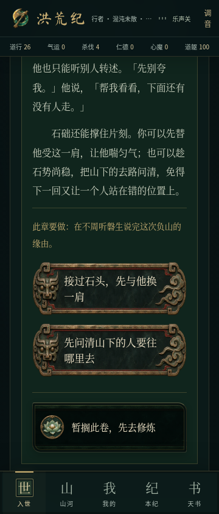
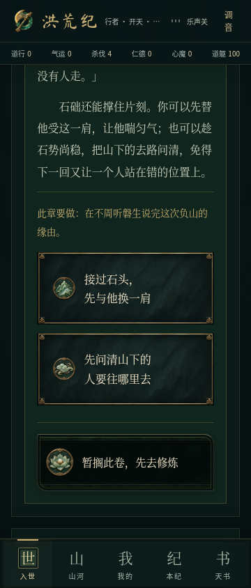
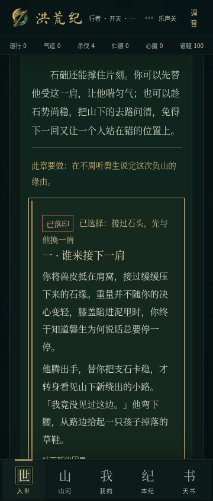
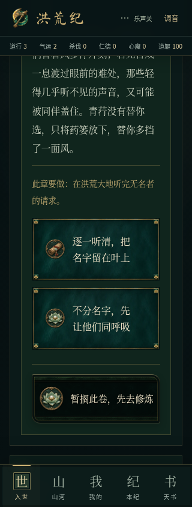
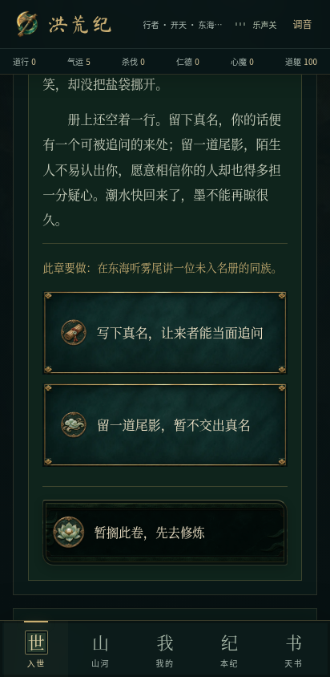
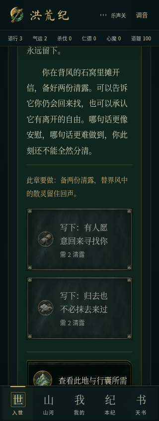
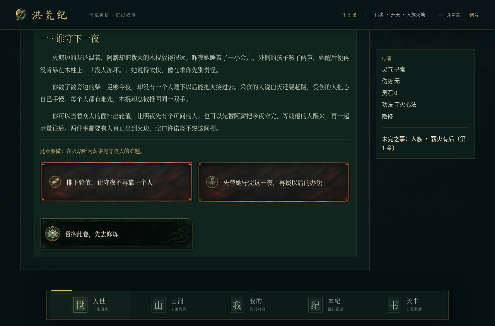

# 族脉选项牌面与阅读空间验收

制作与验收：2026-11-09，交付：2026-11-10。`feat/painted-choices`，接续 `feat/epic-encounters@8bf39b0`。这轮专注剧情选项的美术识别和阅读操作；没有修改剧情分支、数值、存档格式或音乐。

## 实际修改

灵、巫、妖、人四族的 48 个既有剧情选项使用四种原画牌面：玄青玉、黑岩古铜、暮青羽纹、焦木赤铜。四个本地 WebP 共 **42,534 字节（约 41.5 KiB）**。边框按九个区域分别缩放，文字变长时保留角部雕纹；手机单列、桌面双列。每个选择搭配既有绘画徽记，表示眼前行动意图，不展示隐藏收益或结局。

正文仍为 HTML 文字，支持中文换行、键盘焦点、禁用和既有落印反馈。新牌面集中用于族脉分支选择；续读、修炼、战斗及旧篇的既有美术继续保留。来源、生成提示词、尺寸与九切说明见 [素材记录](../../public/art/painted-choices.md)。

## 复现与修复

1. **长结果只露几行。** 原阅读定位最少仅留 150px，结果开头靠近底栏时，玩家需要再次手动寻找正文。先新增 12 项单测，旧实现 8 项失败；现按目标高度、顶栏、底栏和可视视口计算阅读空间，为长段预留可读区 65% 的正文空间，短段充分可见时不移动。只在显式操作后最小滚动，焦点始终 `preventScroll`，没有订阅挂机状态。
2. **提示没有被读屏关联。** `aria-label` 覆盖了按钮内部材料、风险等独立提示。现在通过独立 ID 与 `aria-describedby` 关联；旧篇自定义按钮内容也包含提示。若成本已在名称中，则不会重复朗读。自动化验证的是浏览器语义关系，未宣称 Android TalkBack 真机验收。
3. **两个分支外观同形。** 保留已有图像体系，用四族材质与不同的行动徽记区分抉择；薄框释放装饰空间，标题自动平衡换行。独立代码复核还发现并修正了图章定位被通用样式覆盖的问题。

## 验证

- `npm run typecheck`、`npm run lint`、`npm test` 通过：197 项脚本测试 + 179 项 TypeScript 测试，共 **376 项**，其中本轮新增 12 项阅读定位回归。
- **40 项不同浏览器用例通过**：新增选项与语义检查 16 项，既有阅读 12 项、境内游历 12 项，均覆盖 320／360／412px 手机和 1280px 桌面。新增 16 项和阅读 12 项另在正式构建完整复测通过。
- 实际检查四种本地图像解码、九切参数、文字空间、行动意象、键盘确认、快速重复点击只提交一次、长结果可读空间、材料不足不能提交、成本提示与旧篇自定义按钮的无障碍关联；360px 用例启用减少动态效果。
- 既有回归包括后台挂机保持阅读位置、战后返回原面板、明确续读及人物托付。新用例未发现横向溢出、页面或控制台错误。
- 开发与正式版启动烟雾检查通过并实际查看桌面／手机截图，无基线偏差。首次桌面截图曾赶在异步图片解码前，脚本补充 `img.decode()` 等待后复测。通用检查误用 `/workspace` 为根目录而发出分享图提醒，仓库根目录 `brand-check --game` 实际零警告。
- `npm run build`、`npm run build:android` 通过；四张新牌面逐字节进入离线构建。未配置数据库，按原规则跳过迁移；仍有主 JS 包大于 500 kB 的构建提示。
- 本轮差异与新增文本进行常见 Token、API 密钥、私钥及 AWS Access ID 模式扫描，未发现命中，未打印密钥。这不是全面安全审计。

## 边界

新牌面是静态原创绘画配现有按压／落印效果，不是序列帧动画。本轮没有扩写小说或增加玩法系统，未触碰音乐，未重打原生 APK 或进行真机测试。旧下载 APK 不含本轮美术；Android 离线网页构建仅证明可打包资源，不能代替原生验收。

开发服务最初未运行造成两次连接拒绝；启动持久开发服务后才运行验收，没有将连接失败计作通过。未合并 main 或正式发布。

## 截图与记录

| 之前：厚铜牌 · 360px | 现在：巫族牌面与意象 · 360px | 长结果阅读空间 · 360px |
| --- | --- | --- |
|  |  |  |

| 灵族玄玉 · 320px | 妖族羽纹 · 412px | 材料不足 · 320px |
| --- | --- | --- |
|  |  |  |

[新增开发版 16 项](../../screenshots/painted-choices/dev-results.json) · [正式版 16 项](../../screenshots/painted-choices/production-results.json) · [阅读正式版 12 项](../../screenshots/painted-choices/reading-production-results.json) · [游历回归 12 项](../../screenshots/painted-choices/living-dev-results.json) · [离线资源](../../screenshots/painted-choices/offline-assets.json)
