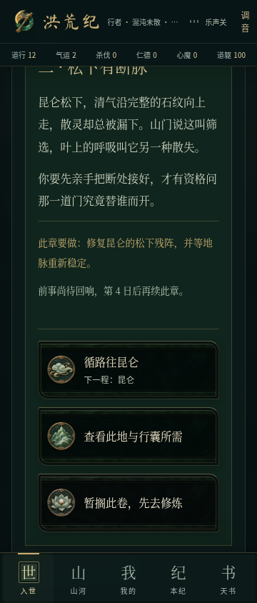
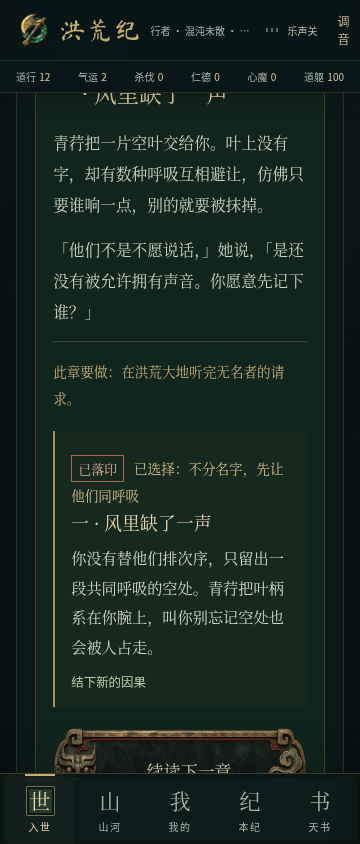
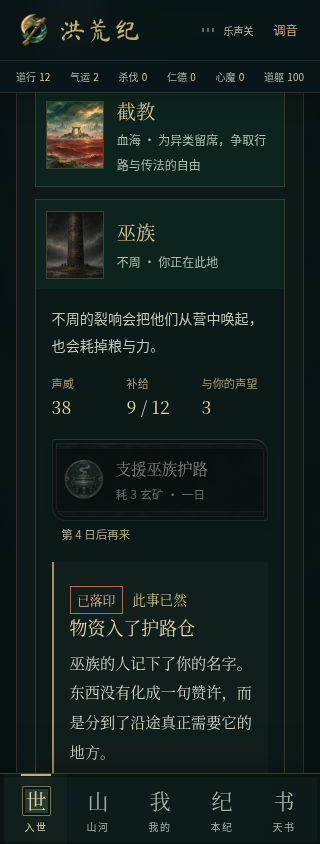

# 族脉阅读与战后衔接修复

2026-11-07；基于 `feat/factions-lineages` 的 `e498457`，独立分支 `fix/lineage-reading-flow`。本轮只修体验衔接，不扩写故事、不更换音乐或美术、不改奖励及存档结构。

## 先复现，再修复

360px 浏览器实际点击后：

1. 族脉选项结果的起点在视口上方 `-191.75px`，同时换成下一章正文，玩家容易漏读结果。
2. 巫族支援结果的起点在视口上方 `-525.55px`，与触发它的操作分离。
3. 试炼结束后，“族脉”标签失去选中状态，自动回到修行。巡护也会丢失“世局”面板。

新增 `scripts/reading-flow.browser.mjs` 先得到三项失败，修复前记录和截图随报告保留。

## 修改

- 族脉选择在原选项附近显示“已落印”、所选行动、结果与已发生的变化。旧选项立即撤下，原章正文保留；点击“续读下一章”或“查看此卷结局”后再切换阅读内容。
- 续读只切换界面，不再调用游戏行动，不额外扣物资、推进日数或发奖励。进度在作出选择时仍照常保存，刷新后可以从章节档案重读。
- 支援、递停战书的反馈显示在对应势力、对应按钮旁；不再在面板顶部重复一份无关的旧报告。
- 战前面板状态保留在入世页面，试炼和巡护胜利、失败、脱身后都能继续原任务。战斗中读档时也按战斗类型恢复族脉或世局。
- 只在玩家明确操作后将结果起点移入可读区域并聚焦，后台更新不会触发这一逻辑；计算固定顶部、底部导航及可视视口的遮挡。
- 道躯不足 20 的试炼按钮说明原因，并提示去调息。

## 验证

- 自动化测试：332 项通过（197 脚本 + 135 TypeScript），包括新增低道躯试炼条件回归；全部八种族脉结局、存档兼容和既有长程模拟一并通过。
- TypeScript、Lint：通过，无错误或警告。
- 网页正式构建、安卓离线资源构建：通过。数据库未配置时按原项目规则跳过迁移；本地存档无需数据库。Vite 仍提示现有主包超过 500kB，未因此重构打包架构。
- 浏览器检查覆盖 320、360、412、1280 像素：新阅读衔接 12 项、族脉/世局既有流程 12 项、入世反馈/挂机/功法既有回归 20 项；共 44/44 通过；新回归在正式构建再次通过，包含战斗中刷新后续玩。
- 开发和正式构建首屏一致，无横向溢出或控制台错误。首屏脚本的品牌警告仍因把 `/workspace` 当成项目根目录；真实仓库含 `public/og.jpg`，独立品牌校验为 0 警告。

## 对比

| 修复前：结果在视口上方 | 修复后：结果留在选项附近 |
| --- | --- |
|  |  |

本次差异的常见 GitHub Token、AWS Access Key 和私钥模式扫描无命中，未输出密钥。

[修复前回归结果](../../screenshots/reading-flow/before-results.json) · [正式构建回归结果](../../screenshots/reading-flow/results.json)。

安卓安装包由开发分支的现有工作流构建，结果见后续记录。真机安装、音频听感、飞行模式、系统后台恢复不包含在浏览器尺寸测试中。
