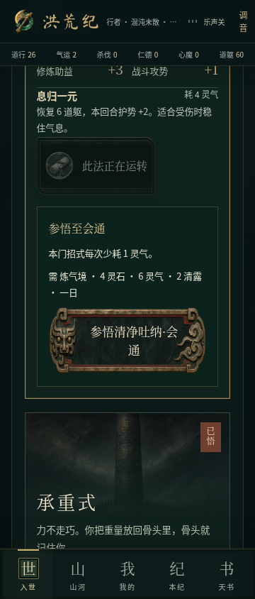
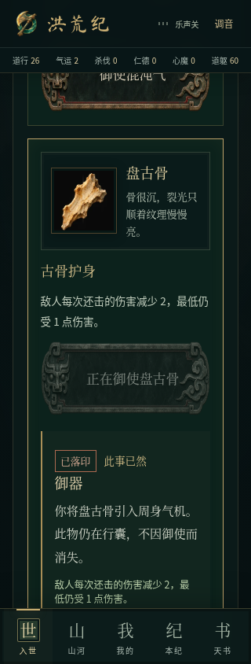
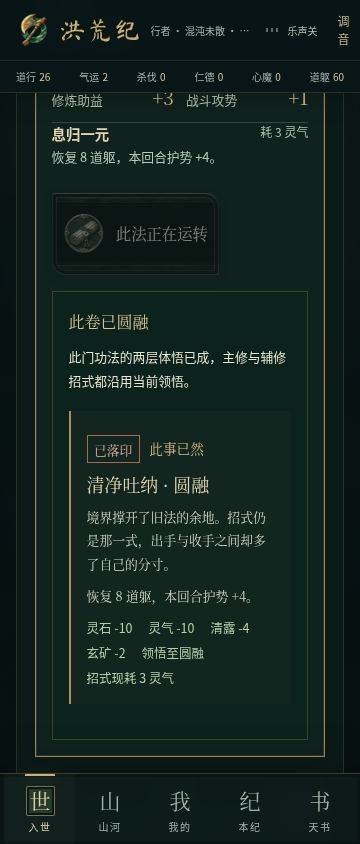
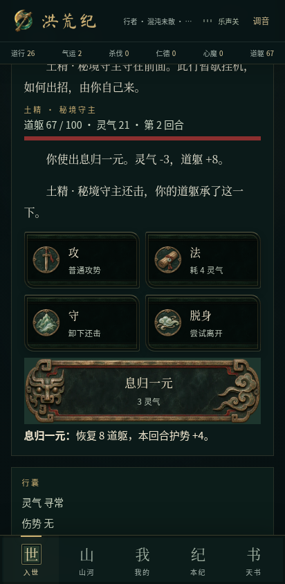
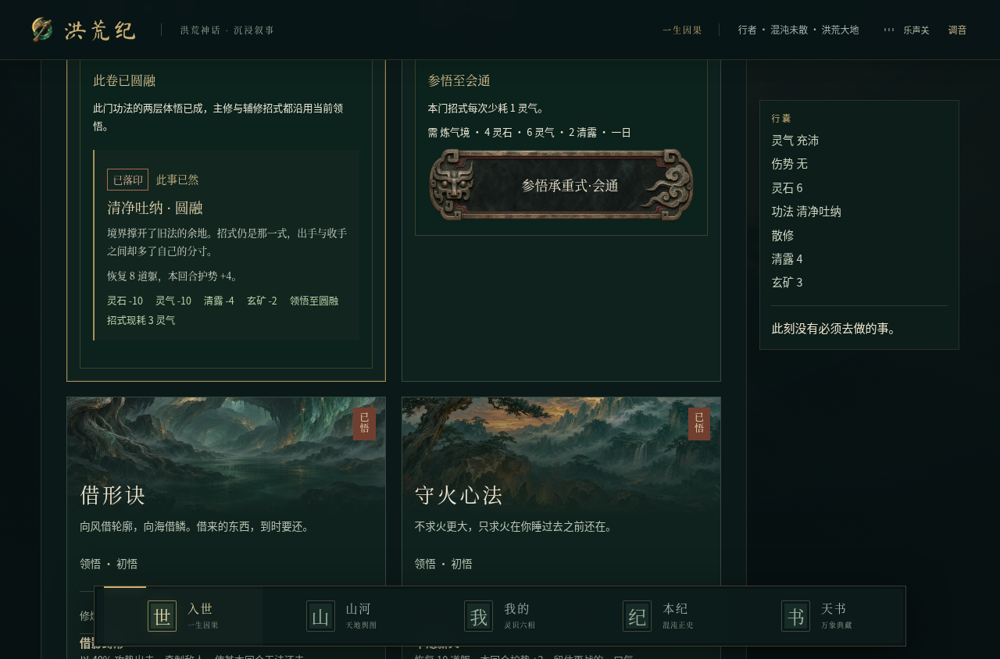
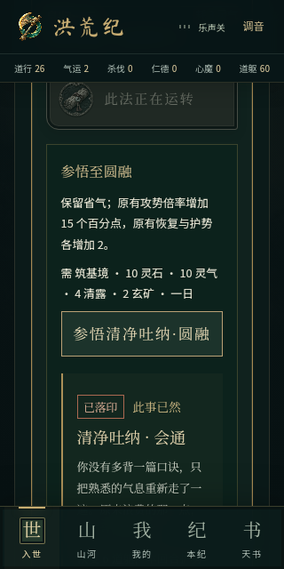
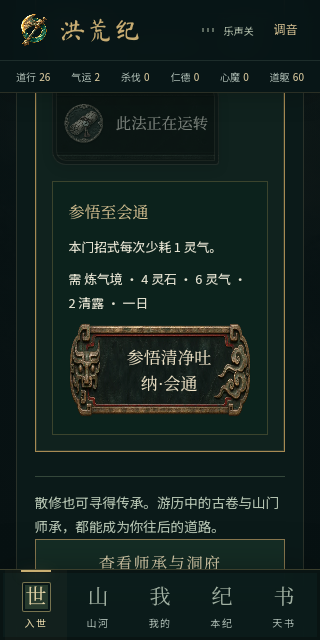
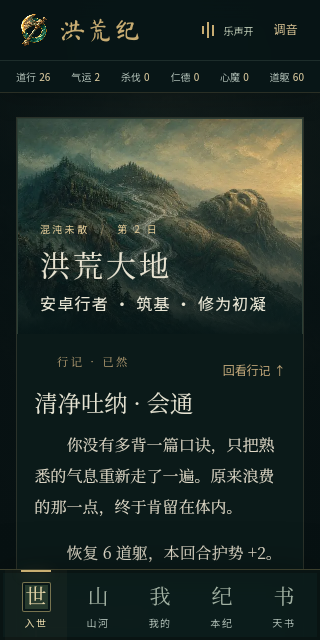

# 御器与功法参悟验收

2026-11-08，分支 `feat/relics-and-insight`；基于 `fix/lineage-reading-flow@057953b`。这轮补两处真实的成长缺口，不改原小说、音乐或已有器物收藏效果。

## 实际修改

储物新增「御器」，点击已有器物能打开原画与详情。同一时刻只御使一件；收起、换用不消耗收藏。换器先按旧配置结算已过去的挂机。战中、事件中、闭关中不能更换。

| 器物 | 开放游历中的用途 |
| --- | --- |
| 混沌气 | 主动闭关一日耗灵气 2→1 |
| 盘古骨 | 每次还击伤害减 2，最低仍受 1 |
| 紫气一缕 | 大境界突破机会加 5 个百分点，保留原上限 92% |
| 诛仙剑意 | 斗法基础攻势加 2，参与普通攻击和招式计算 |
| 巫血 | 受击前道躯低于 50，伤害减 3，最低 1 |
| 钟声一缕 | 每场第一回合的还击伤害减 4，最低 1 |
| 息壤 | 成熟药圃采收额外 2 灵草，不提前成熟 |
| 不周石 | 主动调息额外恢复 3 道躯，最高 100 |
| 人族香火 | 斗法获胜恢复 4 道躯，最高 100；失败/脱身不生效 |

功法藏卷新增初悟→会通→圆融。会通需炼气境，消耗 4 灵石、6 灵气、2 清露、一日；招式少耗 1 灵气。圆融需筑基境，再消耗 10 灵石、10 灵气、4 清露、2 玄矿、一日；保留省气，原有攻击倍率加 15 个百分点，原有治疗/护势加 2。不会给本无治疗或护势的功法凭空增加此能力。

主修、辅修、手动和自动战斗都读取实际领悟。材料不足时不扣费；参悟先结算并停止挂机，再次核对资源。动作携带目标级别，重复的旧动作不会跳到下一层重复花费。费用和已知能力公开，剧情隐藏收益仍在选择后揭晓。结果使用已有落印与局部阅读反馈。

## 截图复核发现的样式覆盖

Android 模拟器首轮功能通过后，截图显示主修与参悟按钮仍是普通矩形。浏览器新增计算样式断言先复现失败：`.art-scroll button` 的旧背景规则优先级高于绘画控件。最小修复只让该旧规则作用于 `:not(.game-action)`，保留普通按钮布局；主修和参悟重新使用原有青铜纹样。

新断言同时加入浏览器和 APK 检查。修复后四种宽度在开发、正式构建各 12/12 通过。开发回归期间一次元素失效超时，在停止并发构建后完整复跑通过；没有把该次失败记成通过。保留 [样式修复前的失败记录](../../screenshots/growth/style-before-results.json) 与原生截图对照。

## 存档与验证

新增 `world.relic`（默认 null）和 `world.insights`（默认空表），保持现有存档版本。迁移过滤不存在的器物、未学或非法等级；实际御器还须拥有对应收藏。原人物、法宝、旗标、小说记录和旧篇规则保留。

- `npm test`：350 项通过（197 脚本 + 153 TypeScript），本轮新增 18 项，包含迁移、旧动作防扣费、九器作用、挂机结算顺序、失败/脱身和上限。243 种器物×主修×策略组合对照手动/自动战斗的生命、灵气与伤势；既有连续行动模拟一起通过。
- TypeScript、Lint、正式构建、安卓离线网页构建：全部通过。外部数据库未配置，迁移按原项目规则跳过；本地存档不依赖数据库。Vite 仍有主包超过 500 kB 提示。
- 新功能开发及正式构建浏览器各 12/12 通过，覆盖 320、360、412、1280px；实点九器详情、换器/收起/刷新、两层参悟的确切扣费、旧记录保留、参悟后真实斗法。360px 使用减少动态效果。无横向溢出与控制台错误。
- 正式构建另通过阅读衔接 12/12 和游历反馈/挂机/功法回归 20/20，合计 44 项。首屏开发与正式版可见正文一致、无页面错误或横向溢出；冷启动截图有一次早于图片绘制，等图片解码后补拍确认两者原画正常。冒烟脚本的品牌警告源于错误使用 `/workspace` 为根目录；仓库 `brand-check --game` 为零警告。
- 本轮差异与新增文本文件的常见 Token、API 密钥、私钥模式扫描无命中；未打印凭据。这不是全面安全审计。独立只读代码复核未发现阻塞问题。
- Android 15 / API 35 模拟器：5/5 实际流程通过，并通过绘画按钮样式断言。实装 APK，飞行模式冷启、十二个本地音频解码、御器/参悟扣费保存、系统 HOME 后音乐停止并按原位置续播、强停后离线读档，均已运行；不是仅添加脚本。

## 边界

御器和参悟有意增加可选的成长效果；未御器、未参悟时沿用原数值。没有更换美术或音频文件，也没有给收藏品增加破坏性消耗。长期收益平衡仍需玩家实测；真机与听感边界见 [完成情况](../completion-status.md)。

## 截图与机器记录

[新功能 12 项](../../screenshots/growth/results.json) · [阅读 12 项](../../screenshots/growth/reading-production-results.json) · [原游历 20 项](../../screenshots/growth/roam-production-results.json)

| 九器御使 · 320px | 功法参悟 · 360px | 实战 · 412px |
| --- | --- | --- |
|  |  |  |

## Android 构建与包内检查

- 原生 APK 构建成功：[运行 42440509568](https://github.com/mistwood38/honghuang-ji/actions/runs/42440509568)，游戏代码 `51e6cb53347a2b9ada827e23bc5eda46f85dd975`。
- [下载测试包](https://github.com/mistwood38/honghuang-ji/actions/runs/42440509568/artifacts/13601382781)：22,984,883 字节，约 21.9 MiB，产物保留至 2026-11-22。解压得到 `app-debug.apk`。
- 实际下载的 artifact ZIP 摘要与 GitHub 一致。APK 内含御器、参悟代码、12 个音频文件和 67 张图片；音频逐一与本地源文件一致；没有配置远程网页为客户端入口。`art/` 另有 9 份来源文档，共 76 个文件，图片数量不含文档。
- APK SHA-256：`24b97b924f030c6f684d81bda7be5552390670979d8a5eee4e99035070ea9cda`。
- [包内校验记录](../../screenshots/growth/apk-validation.json)。这是 debug 测试包，未合并 main 或发布正式版。

## Android 模拟器实测

最终原生构建及模拟器任务均通过，见上述运行记录。使用隔离模拟器和测试存档；飞行模式实际开启，Wi-Fi 与移动数据关闭。

[5 项运行结果](../../screenshots/growth/android/results.json) · [下载原生测试证据](https://github.com/mistwood38/honghuang-ji/actions/runs/42440509568/artifacts/13600818859)

| 修复前：旧规则覆盖 | 修复后：实际 APK 铭牌 | 强停后离线续玩 |
| --- | --- | --- |
|  |  |  |

首轮运行曾因 Playwright 对 WebView 下发不支持的 `Browser.setDownloadBehavior` 而中止；连接改为 `noDefaults: true`，保留原生焦点/生命周期，再运行通过。之后图片复核发现并修复上述按钮覆盖，最终 APK 又完整重跑通过。没有把失败或旧包的结果算作最终包通过。

模拟器无人工听感验收；真机性能、长时后台/耗电、扬声器音质与跨签名覆盖安装仍未验证。完整完成/未完成清单见 [当前状态](../completion-status.md)。
