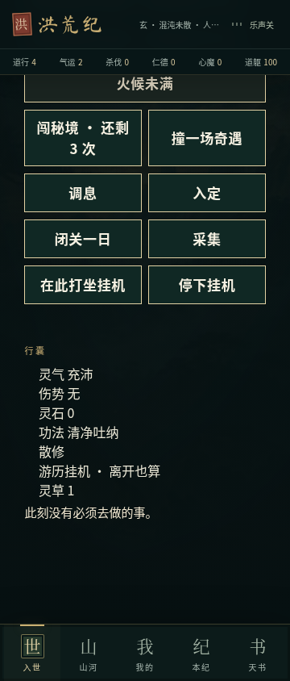

# 游历交互修复记录

日期：2026-11-04。基于 `play/open-cultivation@d67a2b5`，保留 `2e8aab5` 的防重复挂机结算与时钟回拨修复。本次只修复审查确认的问题，没有扩展战斗、功法、小说或动态世界系统，没有增加存档字段或修改物价、奖励与掉率。

## 问题与修复

| 问题与复现 | 修复后 |
| --- | --- |
| 奇遇 `stone-1` 选择“埋回山根，拍实”后，两段结果正文写入了存档却不显示 | 结果正文与“已然”统一显示在操作面板之前，不因回到挂机界面而丢失 |
| 停止挂机后，下一个 2.5 秒回合又恢复挂机；打坐也会被变成刷怪 | 界面定时器和引擎均检查挂机模式，停止状态与打坐状态不会被战斗回合覆盖 |
| 普通界面没有采集、闭关和停止入口；引擎动作无法实际使用 | 恢复这些按钮及恢复挂机按钮，增加“游历”分页，直接使用已有旅行规则 |
| 手动旅行到新地点后，又被旧地图的挂机回合拉回 | 手动旅行暂停挂机；玩家恢复游历挂机时，使用当前地点 |
| 购买前不显示价格，购买后储物页也没有交易反馈 | 买卖按钮显示目录中的实际灵石价格；买卖后当前储物页保留，正文和收支立即可见 |

## 回归与验收

先添加回归测试，再修改产品代码。修复前新增的四个引擎测试均失败；360px 浏览器用例也确认正文不可见、价格和停止按钮缺失。

- `npm test`：287 项通过（197 个脚本测试 + 90 个 TypeScript 测试），包含旧存档导入用例。
- 新增的四个引擎测试：停止后经过读档、定时回合和离线同步仍保持停止；打坐不转为战斗；旅行不被拉回且在新地点恢复挂机；各集市显示价格与实际扣款/收款一致。
- `npm run typecheck`、`npm run lint`：通过，Lint 无警告。
- `npm run build`：通过。无 `DATABASE_URL`，现有迁移脚本按设计跳过服务器数据库迁移；游戏存档继续使用原有本地持久化。
- 开发版和正式构建均完成 320、360、412 × 844 的 9 项交互检查：奇遇结果、买卖反馈、停止/采集/闭关/旅行/恢复挂机。
- 360px 下停止后等待 5.2 秒及触发可见性回调，状态不变；恢复挂机后等待 5.2 秒，修为继续变化，`scrollTo` 调用数为 0。
- 桌面 1280 × 800 与手机 390 × 844 的开发及正式构建烟测：内容正常、无横向溢出、无控制台或页面错误；最终正式构建与开发版基线一致。已人工查看桌面、手机及交互截图。
- 新增和待交付的文本改动扫描未发现高可信度凭据；不在日志中输出密钥。

复跑交互检查（先启动开发服务或正式构建预览）：

```sh
node --experimental-strip-types scripts/roam-feedback.browser.mjs http://127.0.0.1:8080/
```

工具与限制：当前环境没有仓库说明中的 `agent-browser`，两次确认不可用后使用 Playwright 与系统 Chromium。初次并行正式构建检查中，烟测捕获到短暂加载态，交互脚本的 2.5 秒等待也过短；随后单独复查烟测、为交互脚本设置 10 秒等待并静音测试存档，最终全部通过。烟测品牌检查固定检查 `/workspace`，会提示缺少 OG；实际仓库的 `public/og.jpg` 存在且未修改。本次未构建 APK、未进行安卓真机或长时间后台挂起测试。

## 正式构建截图

### 奇遇结果正文与已发生变化


### 储物页的交易价格与结果


### 恢复的主动操作与挂机控制


